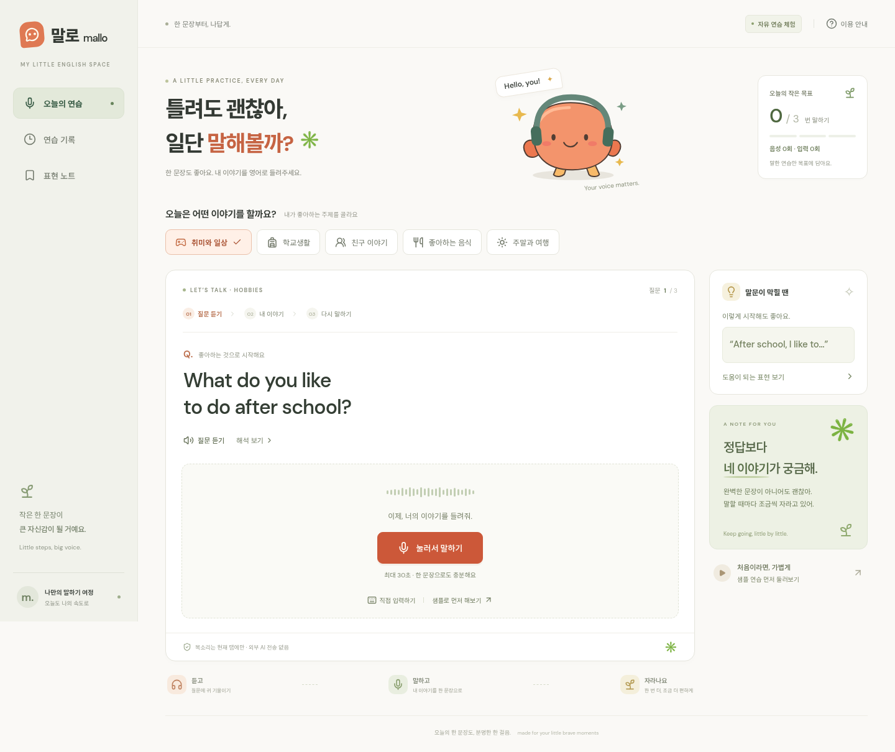
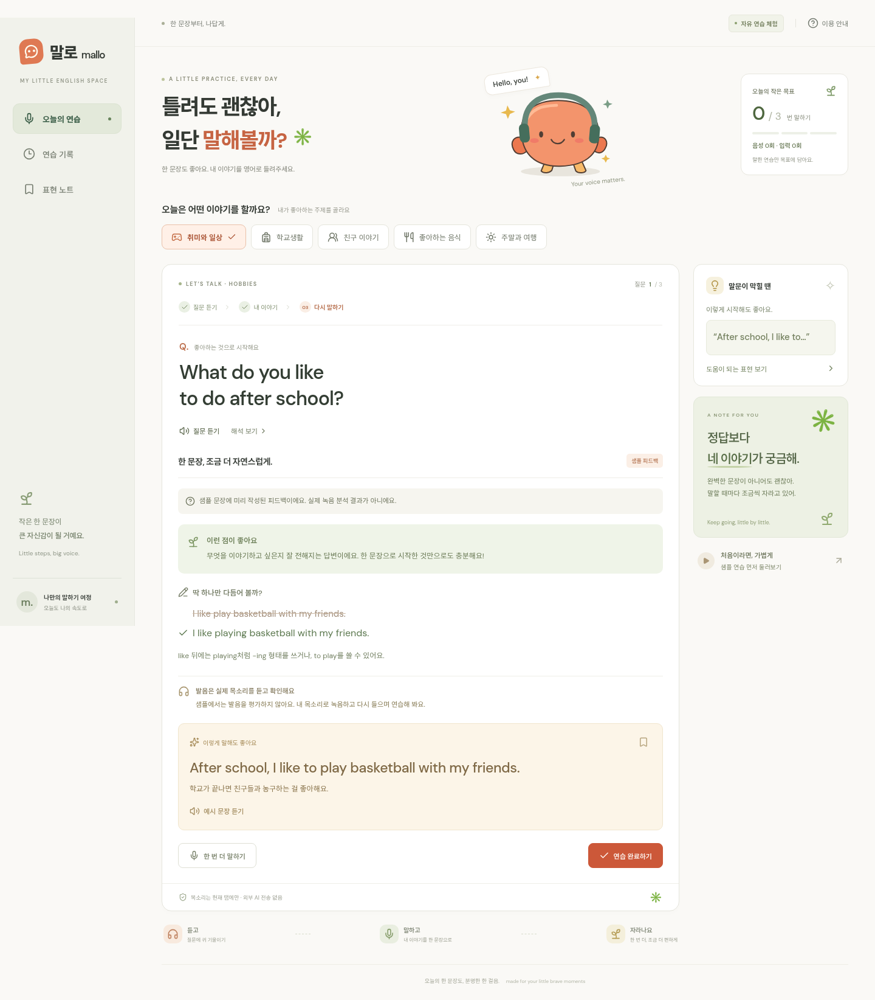
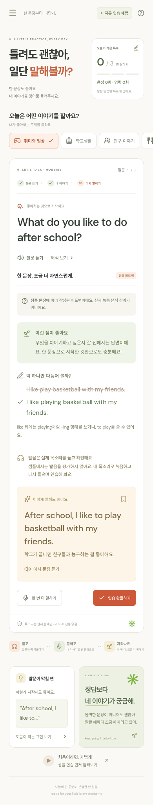
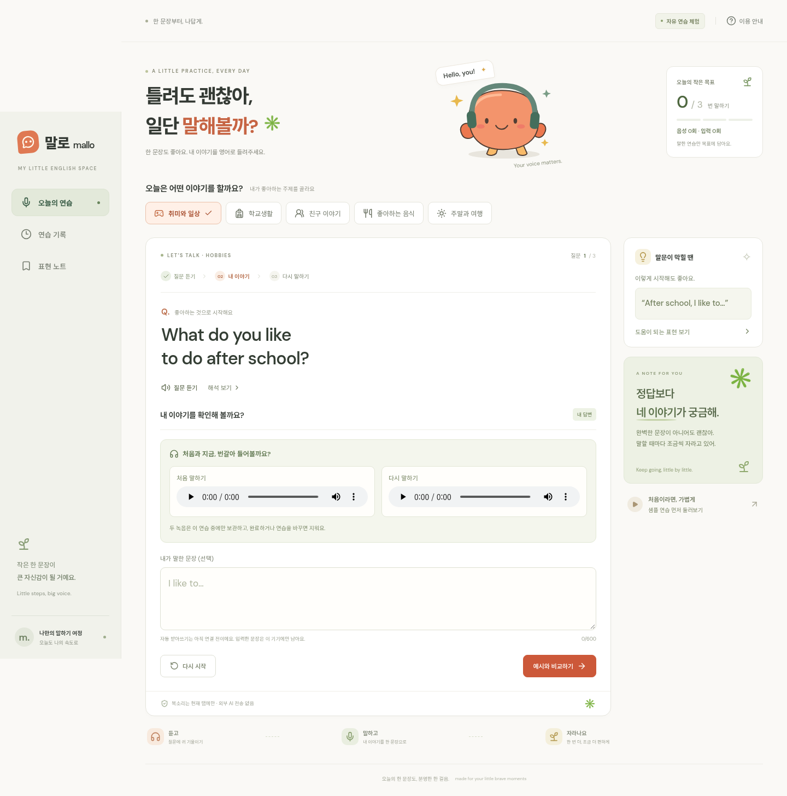
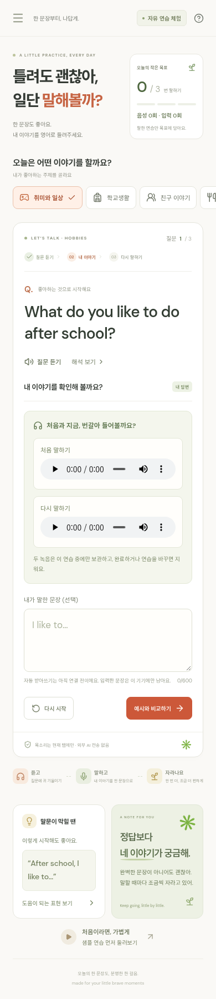

# 말로 — 첫 버전 검토

API 키 없이 사용할 수 있는 앱입니다. 외부 AI 서비스에 연결하지 않았으며, 공개 배포 상태는 GitHub Actions의 Pages 실행 결과로 확인합니다.

**이 파일은 화면 설명 문서이며 실행형 미리보기가 아닙니다.** 앱을 직접 체험하려면 [`mallo.html`](../preview/mallo.html)을 내려받아 브라우저에서 여세요. 파일이 없다면 저장소에서 `npm run build:preview`로 생성할 수 있습니다. 문서 뷰어에서 오류가 생길 때는 아래 PNG 파일도 각각 직접 열 수 있습니다.

- [PC 첫 화면 PNG](desktop.png)
- [샘플 피드백 PNG](feedback.png)
- [모바일 화면 PNG](mobile.png)

## 첫 화면

5개 주제에서 질문을 고르고, 질문과 예시 음성을 듣고, 최대 30초 동안 녹음할 수 있습니다.

## 샘플 피드백

샘플 답변의 문법 교정 예시를 보여줍니다. 학생의 실제 음성을 분석한 결과는 아니며 화면에도 이를 표시합니다. 직접 녹음하거나 입력한 답변은 자동 교정 대신 자기 점검과 예시 비교로 이어집니다.

## 휴대폰 화면

메뉴, 질문, 녹음, 피드백 화면이 작은 화면에 맞춰 배치됩니다. 실제 휴대폰의 마이크와 스피커는 기기별 확인이 필요합니다.

## 처음과 다시 말하기 비교

연습을 완료하기 전에 다시 말하면 처음 녹음과 최근 녹음을 번갈아 들을 수 있습니다. 한 녹음을 재생하면 다른 녹음은 멈추며, 두 녹음은 완료 또는 연습 전환 시 모두 지웁니다. 예시 화면의 음성은 자동 테스트용 가상 마이크로 녹음했습니다.

실행·검증·배포 방법은 [README](../README.md)를 참고하세요. 소유자가 후속 수정과 배포를 승인한 버전입니다.
